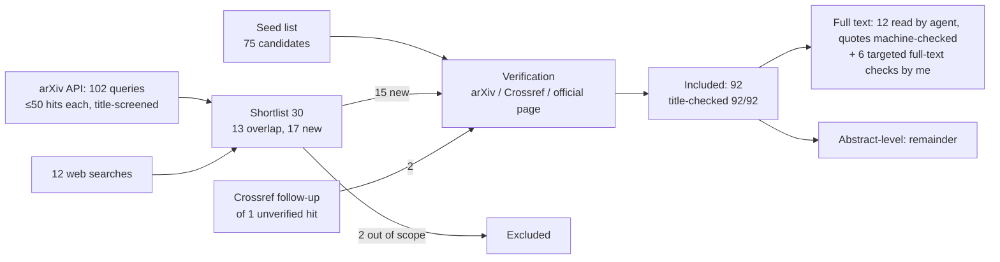

# MathGen — Literature Review (Milestone 2)

**Status:** complete. The proposals in §4 were adopted by the user on 2026-10-17 and frozen in the M3 pre-registration. The locked scope is unchanged.
**Searched:** 2026-10-17. Coverage runs to that date, with arXiv as the main source (see §6 for limitations).
**Companions:**
- [`RELATED_WORK_TABLE.md`](RELATED_WORK_TABLE.md): per-paper comparison and the full reference index;
- [`RESEARCH_GAP.md`](RESEARCH_GAP.md): gap statement, checked against the closest papers;
- [`REFERENCES.bib`](REFERENCES.bib): generated, verified bibliography.

**Evidence rule:** every paper cited here was verified against arXiv, Crossref or its official venue page (§2.3). Claims about papers marked **†** come from reading the full text, with verbatim quotes and section locations in [`artifacts/m2_closest_papers_notes.md`](artifacts/m2_closest_papers_notes.md), or in §2.4 for the ones I re-checked myself. Claims about all other papers come only from their abstracts. Years in the text are first-submission years on arXiv; confirmed venues, with their own years, are listed in the reference index.

---

## 0. Key takeaways

1. **Number tokenization matters most when data is scarce, and the direction is mostly, not entirely, settled.**
   - For integer arithmetic trained from scratch, single-digit tokens beat multi-digit ones: Zhou et al. 2024†, Yang et al. 2024 (Number Cookbook)†, Kreitner et al. 2025†, Baeumel et al. 2026†.
   - The advantage shrinks with more data: Nogueira et al. 2021† saw almost all representations exceed 99.9% at 10M examples. It also shrinks at larger model size, at least in Number Cookbook's 3B runs.
   - The one counterexample is linear algebra: Charton 2021† found P1000 beats P10 at tens of millions of examples.
   - Nobody has compared tokenizations across several structured-math families at matched compute.
2. **The tokenization effect seems to be an output-supervision effect** (Baeumel et al. 2026†, 3.4M-parameter models, 10 seeds). Our planned arms change input and output tokenization together, so the design has to address this.
3. **Within the trained length range, small from-scratch models usually generalize to unseen instances.**
   - Lee et al. 2023† reach ~100% on excluded operands; Zhou et al. 2024† report train ≈ eval accuracy.
   - On longer or larger operands they collapse. This is one of the most replicated results in the area: Nogueira†, Lee†, Saxton†, Zhou†, Kasliwal†, Welleck†.
   - So our H4 bundles two different questions, and the literature predicts opposite outcomes for them (§3.2).
4. **Positional encoding involves a trade-off.** RoPE gives the best *in-distribution* accuracy on number tasks, down to 1.3M-parameter models, but NoPE/ALiBi length-generalize better (Number Cookbook†, Kazemnejad et al. 2023, McLeish et al. 2024†). H6 should predict opposite signs on the two test types.
5. **Repetition is not the enemy of generalization.** Small, heavily repeated training sets can beat single-use data at a fixed step budget (Charton & Kempe 2024†). The number of distinct instances (data budget) and the number of examples seen (training budget) have to be varied separately.
6. **MathGen's "hints" are worked solutions that end with the answer.**
   - Hints-first is therefore a scratchpad condition; answer-first is direct computation followed by a rationale ("post-thinking", Chen et al. 2024).
   - The scratchpad literature predicts large gains for multi-step templates and small ones for single-step templates (Lee et al. 2023†, Nye et al. 2021, He et al. 2026).
7. **Seed variance is rarely reported in this literature** (Lee†, Zhou†, Saxton†, Charton†, Kasliwal†: none or a single seed), and it is known to be large for out-of-distribution metrics (Zhou et al. 2024). Our ≥3-seed design is good practice, not a contribution in itself.

---

## 1. Scope

The working research question from M1 (see `REPOSITORY_AUDIT.md`) asks how number tokenization and positional/FFN choices affect answer correctness in ~5M-parameter decoder-only Transformers trained from scratch on multi-family structured math. It also asks how much in-distribution accuracy is memorization rather than generalization. The review covers nine themes, chosen to inform each hypothesis and the evaluation design:

| Theme | Informs |
|---|---|
| T1 Number representation and tokenization | H1 / H1′ |
| T2 Positional encoding, length and operand OOD generalization | H4 / H4′, H6 |
| T3 Memorization vs generalization | H3 / H3′ |
| T4 Data efficiency, repetition, phase transitions | data-efficiency curve |
| T5 Structured math with sequence models | task framing, closest prior systems |
| T6 Architecture components at small scale | H6 / H6′ |
| T7 Split design and generalization taxonomy | seen / unseen / block / OOD splits |
| T8 Output ordering: scratchpads, hints, answer-first | hints-first vs answer-first control |
| T9 Evaluation statistics and reproducibility | seeds, CIs, decision rules |

**Out of scope:**
- tool use and program-aided math;
- prompting-only studies of frontier LLMs, except where they inform memorization claims (T3) or tokenization (T1);
- theorem proving;
- natural-language word problems beyond the few needed for framing.

---

## 2. Method

### 2.1 Review type
This is a **structured narrative review** with documented searches and verification, not a PRISMA systematic review. One reviewer (Claude, for the project owner) did the synthesis. Two delegated agents did, respectively, full-text fact extraction and a keyword novelty search. Their raw notes are committed unedited in `artifacts/`.

### 2.2 Identification
1. **Seed list (75 candidates):** written from prior knowledge of the area, which risks selection bias toward well-known work. Every candidate was then verified (§2.3).
2. **Novelty-threat search**, to counter that bias and cover 2024–2026:
   - 102 arXiv API queries, each returning up to 50 results whose titles were screened. The log, with hit counts, is in `artifacts/m2_novelty_query_log.jsonl`.
   - 12 web searches covering venue papers and three venue checks.
   - The agent shortlisted 30 papers: 13 were already in the seed list and 17 were new.
3. **Follow-up:** one hit the agent could not verify (an MDPI paper) was resolved through Crossref. The same Crossref query surfaced one more relevant paper (Singhal & Kim 2025).

### 2.3 Verification (scripted, re-runnable)
`research/lit_scripts/verify_refs.py` checks every candidate:
- **arXiv records:** arXiv API (title, authors, dates, comment, journal_ref, abstract);
- **DOIs:** Crossref;
- **records with neither:** the official venue page.

A title that doesn't match what I believed is flagged, never silently fixed. Output: `artifacts/m2_reference_metadata.json`.

**Venues.** A venue is cited only if it was confirmed on the official proceedings page (OpenReview, NeurIPS/ACL/PMLR proceedings, publisher). Otherwise the paper is cited as an arXiv preprint. Semantic Scholar's venue field is stored as a hint but never used, because it proved unreliable (§2.4).

`REFERENCES.bib` is generated from the verified metadata by `build_bib.py`; nothing in it is typed by hand.

**Results:**
- 92 included references; 92/92 verified.
- 0 not found.
- 1 title corrected: xVal was renamed on arXiv after v1.

**Venue results:** **64/92** have a confirmed venue.
- 60 were confirmed on official pages: OpenReview, NeurIPS/ACL/PMLR/MLSys/AAAI/JAIR/JMLR proceedings, Nature, the publisher API for Elsevier, the official EMNLP 2026 program, ICML's own pages, and STOC's accepted-papers list (Feldman's DOI and pages then came from Crossref).
- 4 rely on publisher-deposited Crossref records: Dror, Wilson, Härmä, and Chen et al. (IEEE Xplore is bot-walled).
- The other 28 are cited as arXiv preprints: no peer-reviewed version exists, or none could be confirmed.

Evidence per paper: `artifacts/m2_venue_checks.json`, merged by `lit_scripts/merge_venues.py`.

### 2.4 Corrections and problems found during verification
Recorded so that nobody repeats them:

| Item | What was believed or reported | What the source says |
|---|---|---|
| xVal (2310.02989) | "A Continuous Number Encoding for Large Language Models" | Now "A Continuous Numerical Tokenization for Scientific Language Models" (renamed in a later version) |
| Huang et al., "Are Non-BPE Tokenizers Ready…" | ICML 2026 (main track), per the search agent | The official ICML page lists it under the **3rd AI for Math Workshop** at ICML 2026 |
| Kreitner et al. 2025 (BitTokens) | "small language models" | nanoGPT-2 with 6 layers, d=768, **117M parameters** (App. D), so not our scale |
| Kasliwal 2026 | ~10.6M models trained on arithmetic | Arithmetic training follows **WikiText-103 pre-training**, which the paper reports as essential. The ablation table uses a **100-problem** set; **single seed** ("Single-Seed Evaluations") |
| Baeumel et al. 2026 | "tiny models, 10 seeds" | Confirmed: 4 layers, d_model 256, ≈3.4M parameters, ReLU, no LayerNorm, **three-digit addition only**, 10 seeds per condition (720 models including the LR/WD grid), fixed 500-problem held-out set |
| Number Cookbook | "small models" | 0.1B / 0.9B / 3B from scratch; one PE table also uses a 2-layer 1.3M-parameter model |
| Semantic Scholar venues | (scripted venue source) | 33 of the 58 checked disagreed with the official page: usually the arXiv year instead of the venue year, sometimes the wrong venue (SCAN listed as ICLR; it is ICML 2018) or the wrong edition (Physics 2.1 listed as ICLR 2024; it is ICLR 2025). Not used |
| arXiv comment fields | (author statements) | Zhou et al. 2023 says "Preprint" but appeared at ICLR 2024. xVal claims a NeurIPS ML4PS workshop, but the official paper lists don't include it; OpenReview shows only an AI4Science workshop poster under the old title, so it is cited as arXiv |
| Renamed venue versions | — | The Hupkes et al. taxonomy and Razeghi et al. were published under different titles; the bib uses the published titles, fetched from Crossref. Chinchilla: the NeurIPS proceedings page gives "An empirical analysis of compute-optimal large language model training", while its Crossref record keeps the arXiv title. The bib follows Crossref |
| DBLP / OpenReview APIs | (planned venue sources) | Both now sit behind bot challenges. Venues were confirmed on official pages instead |
| Internal inconsistencies in sources | — | Lee et al. 2023 give GPT-2 as 85M (§10) and 124M (§1); Narang et al. 2021 give vanilla SuperGLUE as 70.97 in the text and 71.66 in Table 1. Not resolved; we avoid relying on those numbers |

Citation counts were deliberately **not** collected: OpenAlex and Semantic Scholar disagreed by an order of magnitude between preprint and venue records.

### 2.5 Inclusion criteria
Included:
- (a) models trained or evaluated on arithmetic, symbolic math or algorithmic tasks, where the paper informs a theme in §1;
- (b) methodology papers on memorization, generalization splits or evaluation statistics;
- (c) primary sources for the architecture components we ablate.

Excluded: out-of-scope topics (§1), and anything that couldn't be verified.

Search hits excluded at screening:
- 2604.27551 (program synthesis);
- 2604.13082 (Collatz dynamics).

Hits screened out by the search agent and not re-screened by me: 2406.00075, 2410.13857, 2601.22035, 2404.14395 (LLM-scale or off-topic).

### 2.6 Process


---

## 3. Thematic synthesis

### 3.1 T1 — Number representation and tokenization

**What the evidence says.**

*Granularity: finer is better for integer arithmetic.*
- Training Pythia-architecture models from scratch, Zhou et al. 2024† find "a base 10 system is consistently more data-efficient than a base 10² or a base 10³ system". The gap does not close at larger model sizes. Fine-tuned models perform similarly across bases. They attribute the difference to token frequency: digit tokens occur at least an order of magnitude more often.
- Number Cookbook (Yang et al. 2024†) trains 0.1B–3B models from scratch and finds "the one-digit tokenizer shows the best in-domain performance … while three-digit tokenizer exhibits poor performance". The one-digit tokenizer also wins OOD, though at 3B "the two-digit tokenizer matches the one-digit tokenizer".
- Kreitner et al. 2025† (117M, from scratch): "single-digit embeddings consistently outperform subword embeddings" among multi-token schemes.
- In frontier LLMs, splitting numbers into right-to-left 3-digit chunks improves addition by up to 20% over left-to-right chunking, and the gap shrinks with scale (Singh & Strouse 2024†).
- Probing studies point the same way. Pretrained LLMs represent numbers digit-wise in base 10 (Levy & Geva 2024), and character-level embeddings encode numeracy more precisely than subword ones (Wallace et al. 2019).
- In practice, LLaMA and PaLM both split every number into single digits (Touvron et al. 2023†; Chowdhery et al. 2022†, checked sentences).

*Representation matters less as data grows.*
- Nogueira et al. 2021† (mostly pretrained T5) compare seven surface forms. With 1,000 examples the plain decimal form fails from 5 digits on, while position-explicit forms ("10e-based") stay near 100% up to 15 digits.
- At 10M examples "almost all representations achieve more than 99.9% accuracy", so "the limitations of some representations are exposed only when training data is small".

*Output granularity is what matters.*
- Baeumel et al. 2026† separate input and output tokenization in a 2×2 design (≈3.4M parameters, 10 seeds, three-digit addition). Differences in accuracy, training dynamics and internals "are induced by output tokenization and largely invariant to input tokenization".
- Models with whole-number output "do[] not converge reliably across seeds". On their probed checkpoints, holistic-output models score 0.853 ± 0.050 exact match vs 0.986 ± 0.009 for holistic-input/digit-output. Those are the best checkpoints, so the numbers are optimistic.

*Format details beyond the tokenizer matter.*
- Inserting a space token between digits raised exact-match 4×4 multiplication accuracy from 1% to 89% in small from-scratch models (Satariyan et al. 2026).
- Single-token number encodings (xVal; BitTokens) are alternatives, not relevant to our arms.
- At LLM scale with a natural-language trade-off, three non-BPE alternatives did not beat BPE (Huang et al. 2026, ICML workshop).

**Where it disagrees.** In linear algebra, Charton 2021† finds the opposite ranking. "For most problems, P10 is dominated by the more economical P1000, and B1999 never finds its use." That setting differs in almost every respect:
- encoder–decoder models;
- real-valued coefficients in 3-significant-digit scientific notation;
- 10⁷–10⁸ training examples;
- matrix outputs.

So we can't tell whether the disagreement comes from the task family, the data regime or the architecture.

**Implications for MathGen.**
- **The three arms are really two contrasts.**
  - Char vs digit: both give single-digit *number* tokens. They differ in how non-number text and JSON are tokenized, and in sequence length. M1 measured mean lengths of 246 characters vs 109 digit-BPE tokens, and 45% of char-level samples would exceed ctx 256 (F8). The literature predicts no number-representation effect here; any difference will mostly reflect sequence length and context budget.
  - Digit vs bpe-num: this one isolates number granularity, which is where the literature predicts an effect.
- **H1′ ("no detectable difference") is now unlikely for integer arithmetic at our data scale.** The open questions are:
  - (i) does the digit advantage hold for fractions, matrices and calculus?
  - (ii) does it shrink as data grows?
  - (iii) is it output-side?
- **The output-supervision confound** is answered most cleanly with a small decoupled sub-experiment (digit-in/bpe-out and bpe-in/digit-out) at the reference configuration. That's a proposal for M3 (§4).
- **Compute matching has to be decided explicitly.**
  - Singh & Strouse note that a token-matched comparison lets coarser tokenizers "see" more data.
  - Matching steps and examples instead gives finer tokenizers more compute per example.
  - Pre-registration should fix one as primary, report the other, and log tokens seen per run.
- **Separators must stay identical across arms** (Satariyan et al. 2026). F8's `\uXXXX` escapes are a project-specific version of the same confound; the review found no paper that discusses JSON escaping.

### 3.2 T2 — Positional encoding, length and operand OOD generalization

**What the evidence says.**

*Extrapolation to longer or larger operands fails by default.* This is one of the best-replicated results in the area:
- Nogueira et al.†: "neither larger models, more compute, nor more data can solve" it.
- Lee et al.† (§12): "unable to generalize to a greater number of digits beyond what it has been trained on".
- Saxton et al.†: Transformer interpolation 0.76 vs extrapolation 0.50; models "completely failed to add together more numbers than seen during training".
- Zhou et al. 2024†: extrapolation exact match ≈ 0.
- Kasliwal 2026†: 0.00% on unseen 4-digit operands.
- Welleck et al. 2021†: near-100% failure for large coefficients in symbolic integration. 99.4% of training integers were in [1, 100).

*Length generalization can be engineered, but it's fragile.*
- Relative position encodings extend addition from 5- to 15-digit operands (Jelassi et al. 2023).
- Abacus embeddings reach 99% on 100-digit addition after training on 20 digits (McLeish et al. 2024†).
- The right combination of data format and position encoding reaches 2.5× the training length, but the result is "significantly influenced by factors like random weight initialization and training data order, leading to large variances across different random seeds" (Zhou et al. 2024, *robustly*).
- The RASP-L conjecture explains which tasks length-generalize (Zhou et al. 2023).

*Which encoding: there is a trade-off.*
- For length generalization in decoder-only models, NoPE beats APE, RoPE and ALiBi (Kazemnejad et al. 2023). McLeish et al.† write "Rotary Embeddings are weak for length generalization". Number Cookbook† finds "NoPE and Alibi achieve better length generalization than RoPE".
- For in-distribution accuracy, Number Cookbook† finds "RoPE shows the best in-domain performance". This holds even for a 2-layer, 1.3M-parameter model, and "the RoPE always surpasses others" on three further tasks.
- A recent optimization account (Singh et al. 2026) shows rotary attention is exactly relative-offset equivariant, while learned absolute positions "pin" to positions seen in training.

*Within the trained length range, unseen values usually generalize.* Lee et al.† excluded 100, 200 or 500 numbers from training. Reverse-format "exclusion accuracy" stayed at 99.95–100%.

**Implications for MathGen.**
- **H4 conflates two shifts. Propose splitting it for M3:**
  - **H4a, held-out value blocks inside the trained length or magnitude range.** The prior is generalization (Lee Table 1).
  - **H4b, longer or larger operands.** The prior is collapse for every arm, with possibly less collapse for NoPE than RoPE.
- **Operand-length OOD also changes the token count differently per arm.** A digit arm sees one more token per extra digit; BPE splits 4-digit numbers irregularly, as Kasliwal† notes for GPT-2 BPE. The OOD analysis should report results by token length as well as digit length.
- **OOD metrics are the most seed-sensitive** (Zhou et al. 2024). Per-seed reporting is mandatory for H4b.

### 3.3 T3 — Memorization vs generalization

**What the evidence says.**

*Small algorithmic datasets can show generalization well after memorization.*
- Grokking (Power et al. 2022): "smaller datasets require increasing amounts of optimization for generalization".
- Nanda et al. 2023 split training into memorization, circuit formation and cleanup.
- Liu et al. 2022 explain grokking through loss landscapes.
- Doshi et al. 2023 show a network can memorize corrupted labels *and* generalize at 100% at the same time.
- So the train–test gap at the *end* of training can hide very different dynamics.

*Memorization grows with capacity and duplication.*
- In LMs, memorization grows log-linearly with model capacity, the number of duplicates of an example, and prompt context (Carlini et al. 2022).
- Larger models memorize faster, and nouns and numbers are memorized first (Tirumala et al. 2022).
- Deduplication removes train–test overlap, which affects over 4% of the validation sets of standard datasets (Lee et al. 2021).
- Memorization can be quantified by comparing performance on samples *seen* vs *unseen* in training (Magar & Schwartz 2022). That is the same seen/unseen design we plan. Counterfactual memorization formalizes it per example (Zhang et al. 2021).

*Memorization may be necessary.* For long-tailed distributions, memorizing rare examples is necessary for near-optimal generalization (Feldman 2019). Networks fit random labels but learn simple patterns first (Zhang et al. 2016; Arpit et al. 2017).

*LLM math looks shortcut-driven.*
- Accuracy tracks pretraining term frequency, by over 70 points between the top and bottom 10% of terms (Razeghi et al. 2022).
- It drops when only the numbers in a template change (GSM-Symbolic, Mirzadeh et al. 2024).
- Mechanistic and behavioral evidence shows the same:
  - LLMs do arithmetic with a "bag of heuristics" (Nikankin et al. 2024);
  - LMs are "greedy symbolic learners" with U-shaped digit accuracy in multiplication (Deng et al. 2024);
  - learning follows "correlational matching to the training data" (Zhao et al. 2026);
  - compositional tasks are solved by "linearized subgraph matching" (Dziri et al. 2023).

*Small from-scratch math models are more encouraging.*
- Lee et al.†: "surpasses mere memorization" but is "a mapping function constrained to trained digit lengths".
- Zhou et al. 2024† find "nearly identical performance on our training and evaluation set".
- Ye et al. 2024† use a template-level hash split and conclude the model learns "some reasoning skill instead of memorizing solution templates".
- Barron & White 2025 find a capacity trade-off: small models extrapolate arithmetic but fail to memorize facts, larger ones the reverse, and "when trained on both tasks jointly, no model … succeeds at extrapolation".
- Charton 2022 shows careful training-data choice enables OOD generalization, "invalidating the idea that transformers 'merely interpolate'".
- On mixed arithmetic, Saxton et al.† conclude their models learn "relatively shallow tricks".

*Architecture can shift the balance.* Removing LayerNorm parameters in pre-LN models "exacerbates memorization" (Singhal & Kim 2025). Härmä et al. 2026 link memorization capacity in compact transformers to architectural parameters.

**Where it disagrees.** The pessimistic results come almost entirely from pretrained LLMs on natural-language math. The optimistic ones come from small from-scratch models, tested within range, on large instance spaces. No study we found measures the seen–unseen gap *as a function of instance-space size* across many templates.

**Implications for MathGen.**
- **H3 vs H3′ will probably be decided per template, not globally.**
  - The prior favors H3′ (no gap) for large-space templates within range.
  - Our 9 tiny templates make the seen/unseen split nearly ill-defined. limit_factor has only 5 instances, integral_power 12 (F5). M4 must either enlarge those spaces or exclude them from H3, and say so.
  - Instance-space size and per-instance exposure count should be pre-registered moderators (Carlini; Charton & Kempe).
- **Seen-set accuracy has to be measured, not assumed.** Following Magar & Schwartz, "seen" means instances present in training, evaluated with the same decoding. Several closest papers report only test accuracy.
- **Evaluate at intermediate checkpoints, not only at the end** (grokking dynamics). This costs eval time but no extra training.
- **The F3 subtraction bug** (51% of items are x − x = 0) resembles the corrupted-label setting (Doshi et al.). Baseline A reproduces it on purpose. Clean arms must not.

### 3.4 T4 — Data efficiency, repetition and phase transitions

**What the evidence says.**

*Learning curves on arithmetic show phase transitions.*
- Lee et al.†: the reverse format has "a notable phase transition between 1000 and 4000 samples"; the plain format "plateaus at slightly over 85% even with 10,000 samples".
- Output format changes sample complexity a lot: the detailed scratchpad "achieves perfect addition with just 1000 samples".
- Zhu et al. 2024 describe a critical data size separating memorization from generalization, which grows with model size.
- Past that threshold, more data can *slow* convergence on structured-output tasks (So et al. 2026), though not on a multiplication baseline.

*Repetition interacts with diversity.*
- At a fixed training budget, models trained on smaller sets of repeated examples beat models trained on single-use data (Charton & Kempe 2024†). Modular multiplication reached 59.5% with 50M distinct examples vs 3.0% with unlimited data at 600M examples seen. Their reading: "repetition, and possibly memorization, fosters learning".
- In LMs, by contrast, repeating a small fraction of the data many times hurts badly (Hernandez et al. 2022), while up to ~4 epochs is harmless (Muennighoff et al. 2023).

*Small models can be competent on narrow synthetic distributions.* Models under 10M parameters, even single-block ones, produce fluent text on TinyStories (Eldan & Li 2023). Large-scale scaling laws (Kaplan et al. 2020; Hoffmann et al. 2022) are context only; we don't extrapolate them to 5M.

*Training mechanics can masquerade as data effects.* Kasliwal† reports that dataloader padding caused an "83% gradient starvation artifact that collapses accuracy from 40% to 1%". That's the same family of issue as our P2 fixes: dynamic padding and completion-only loss.

**Implications for MathGen.**
- **The data-efficiency curve needs two axes:**
  - the number of distinct instances (the data budget);
  - the number of examples seen (the training budget, held fixed).
- **Space the sizes logarithmically, with extra points near the expected transition** (10³–10⁴ per template family, from Lee et al.).
- **Expect the tokenization effect to depend on data size** (Nogueira; Zhou). The tokenizer × data-size interaction is the most informative single analysis.

### 3.5 T5 — Structured math with sequence models

**Closest prior systems.**
- *DeepMind Mathematics* (Saxton et al. 2019†) is the nearest in task breadth: arithmetic, algebra, calculus, polynomials and more, char-level, ~30M models, with interpolation and extrapolation test sets.
  - Train/test overlap is bounded probabilistically ("at most … 2% of the test questions") rather than deduplicated.
  - No seeds are reported, and tokenization is not varied.
- Lample & Charton 2019† solve symbolic integration and ODEs with seq2seq models and 20–40M examples. A model trained on one generator reaches only 17.2% on another generator's test set.
- Welleck et al. 2021† show the same models are brittle under perturbation and composition ("sparse test sets do not adequately measure systematic generalization").
- Charton's linear-algebra work† covers nine matrix tasks.
- Charton 2023 (GCD) shows the training distribution of operands changes what is learned: log-uniform operands raise the number of correctly predicted GCDs from 38 to 73.
- Physics of LMs 2.1 (Ye et al. 2024†) is the most controlled synthetic-math study, but it covers a single family (GSM-like) with mod-23 arithmetic.
- At larger scale with pretraining: TinyGSM (Liu et al. 2023); GSM8K and verifiers (Cobbe et al. 2021); MATH (Hendrycks et al. 2021).

**Implication.** No prior from-scratch system combines MathGen's mix of exact-integer arithmetic, fractions, 2×2 matrices and power-rule calculus with JSON output, in one model. Multi-task training matters: Lee et al.† found joint training on five operations raised zero-shot multiplication from 4.58% to 14.28%. Barron & White found that joint training with a factual-recall task removed arithmetic extrapolation in every model size. So multi-family training is a factor in its own right, not a neutral backdrop. We hold it constant; we do not study it.

### 3.6 T6 — Architecture components at small scale

**What the evidence says.**

*Most Transformer modifications don't transfer.*
- Narang et al. 2021† find "most modifications do not meaningfully improve performance" (223M encoder–decoder, NLP).
- The exceptions include GLU variants: early-training loss 2.127 ± 0.003 for SwiGLU vs 2.182 ± 0.005 for vanilla (5 runs), consistent with Shazeer 2020.
- They also find relative attention bias beats learned absolute positions "by a significant margin". RoPE was not tested.

*Small-scale arithmetic evidence is thin and confounded.*
- Kasliwal 2026† reports RoPE + RMSNorm + SwiGLU "substantially improve additive reasoning over baseline GPT-2" at ~10.6M non-embedding parameters. But it is one seed, the three components are changed together, and arithmetic training follows WikiText pre-training.
- Ye et al.† saw no benefit from gated MLPs, mentioned only anecdotally in a footnote.
- In 1-layer arithmetic models, GLU gating "rotates task-relevant Fourier structure out of the per-neuron basis and into distributed subspaces … while preserving structured computation" (Smithline & Mascioli 2026). This is a mechanistic result, not an accuracy comparison.

*Components we hold fixed.*
- Pre-LN trains stably without warm-up (Xiong et al. 2020).
- RMSNorm matches LayerNorm at lower cost (Zhang & Sennrich 2019).
- Normalization affects memorization (Singhal & Kim 2025), which is why we keep it fixed across all arms.

**Implications for MathGen.**
- **The prior for H6 is weak, and the evidence is split by test type.**
  - In-distribution: small or no SwiGLU effect at our scale, and RoPE ≥ NoPE (Number Cookbook†).
  - Length OOD: NoPE ≥ RoPE.
- **H6′ (a null result) is a live outcome.** Pre-registration should fix a smallest effect size of interest and use an equivalence test, so that a null can be reported as evidence rather than as absence of evidence.
- **Ablate one component at a time.** Kasliwal's bundled ablation shows why.

### 3.7 T7 — Split design and generalization taxonomy

**What the evidence says.**
- Generalization studies differ along five axes (Hupkes et al. 2022):
  - motivation;
  - generalization type;
  - shift type;
  - shift source;
  - shift locus.
- Compositionality can be tested as systematicity, productivity, substitutivity, localism and overgeneralization (Hupkes et al. 2019).
- Systematic splits expose failures that random splits hide:
  - SCAN: models fail "when generalization requires systematic compositional skills" (Lake & Baroni 2017);
  - accuracy falls as compound divergence between train and test rises (Keysers et al. 2019).
- For synthetic math, the strongest anti-leakage design in the closest work is Ye et al.'s† hash-based **template-level** split: train if hash < 17 mod 23, test otherwise, so there is "no template-level overlap".
- Saxton et al.† bound overlap only probabilistically; Lee et al.† and Zhou et al. 2024† exclude test instances explicitly.
- Template-based perturbation (changing only the numbers) exposes memorization in LLMs (Mirzadeh et al. 2024).

**Implications for MathGen.**
- **Classify each split with the Hupkes taxonomy** in the pre-registration:
  - seen vs unseen instances: none vs instance-level, same distribution;
  - held-out operand blocks: covariate shift within range;
  - larger operands: length/magnitude shift.
- **Instance-keyed hashing with exact dedup** (the P0 fix in M1) is the instance-level counterpart of Ye et al.'s template split.
- **A template-level split** (training on some templates of a topic and testing on others) would test a stronger form of generalization. It's worth listing as an exploratory extension, not as a core arm.

### 3.8 T8 — Output ordering: scratchpads, hints, answer-first

**What the evidence says.**

*Intermediate steps help, but it depends on content and format.*
- Emitting intermediate steps strongly improves multi-step computation (Nye et al. 2021; Wei et al. 2022).
- In small from-scratch models, scratchpads cut sample complexity a lot (Lee et al.†). The costs: 13, 15, 64 and 281 tokens per example for plain, reverse, simplified-scratchpad and detailed-scratchpad formats.
- For tasks a fixed-depth model can't solve in one pass, the chain does real work: "chain-trained models solve every input length and fall to chance when the chain is erased" (He et al. 2026).
- Scratchpad format matters, and scratchpads are "not always helpful" (Kazemnejad et al. 2023; Kasliwal† on a failing multiplication scratchpad).
- Scratchpad supervision does not cure shortcut learning (Zhao et al. 2026).

*Answer ordering and digit order.*
- Answer-first ("post-thinking") fine-tuning of pretrained small models makes the answer robust to rationale errors, but loses decomposition ability (Chen et al. 2024).
- Digit order matters too: reverse (least-significant-first) output helps addition (Lee et al.†; Zhang-Li et al. 2024).
- Nogueira et al.† found regular order extrapolates better than inverse order, with no difference in interpolation.

**MathGen-specific fact** (from `src/dataset.py`): the `hints` are worked solutions with the intermediate values. In most templates they end by stating the final answer: "Then multiply: a × (b+c) = ans", "x = …", "Result = …". Some don't (vec_dot stops before the final sum).

**Implications for MathGen.**
- **Hints-first ≈ scratchpad + copy; answer-first ≈ direct computation + post-hoc rationale.** The literature predicts a large hints-first advantage on multi-step templates (pemdas, fractions, linear equations, f(x) evaluation) and little difference on single-step ones.
- **Pre-registration must report three things separately:**
  - (i) answer-key accuracy;
  - (ii) whether the last hint states a value consistent with the answer key;
  - (iii) per-template results grouped by number of solution steps.
- **The comparison is also a token-budget comparison**, since hints add tokens before the answer. Report it with the compute-matching rule from T1.

### 3.9 T9 — Evaluation statistics and reproducibility

**What the evidence says.**

*Variance is large, and the closest papers mostly don't report it.*
- Variance from data sampling, initialization and hyperparameter choice changes conclusions. Randomizing more sources of variation gives better estimators at lower cost (Bouthillier et al. 2021).
- Point estimates from a few runs mislead. Interval estimates (stratified bootstrap, IQM, performance profiles) are recommended (Agarwal et al. 2021).
- Seed variance in LM evaluation is measurable, and how a task is framed changes it. Madaan et al. 2024 also weigh continuous against discrete performance measures as a way to understand and reduce that variance.
- With enough seeds, outlier runs are easy to find (Picard 2021).
- Expected validation performance should be reported as a function of tuning budget (Dodge et al. 2019).
- Significance testing in NLP needs the test matched to the metric (Dror et al. 2018).
- Reproducibility needs a checklist and code (Pineau et al. 2020).
- The Wilson score interval is a standard per-run CI for an accuracy proportion (Wilson 1927).

*What the closest papers report:*
- **no seeds:** Lee†, Zhou 2024†, Saxton†, Charton†, Lample & Charton†;
- **single seed:** Kasliwal†;
- **mean of 3 runs, no error bars:** McLeish†;
- **5 data samples, 95% CI:** Nogueira†;
- **5–30 seeds:** Charton & Kempe†;
- **10 seeds:** Baeumel†.

Baeumel et al.'s survey of 120 recent *CL papers found "only about 10% report the numeric tokenization of the models they evaluate, while 69% compare across tokenization … without reporting it".

**Implications for MathGen.**
- **The seed is the unit of analysis for between-arm comparisons.**
  - Item-level Wilson CIs within a run understate between-run variance. Use them for per-run description only.
  - Compare arms with seed-level paired tests or bootstrap CIs, pairing on the data seed.
- **Pre-register a continuous secondary metric** (per-item log-likelihood of the gold answer). It is likely less noisy than exact match; Madaan et al. discuss the trade-off.
- **Vary initialization and data order across seeds; hold the data split fixed per comparison.** This is paired; Bouthillier et al. support randomizing multiple sources.
- **Correct for multiple comparisons** (Holm), since there are four hypothesis families.
- **Always report the tokenization of every arm**, since most papers don't (Baeumel et al.).

---

## 4. Proposals for M3 (pre-registration), arising from this review

**Adopted by the user on 2026-10-17** ("RQ v2 + all"). None of them changes the locked scope:

| # | Proposal | Evidence | Cost |
|---|---|---|---|
| P-a | Treat the three tokenizer arms as two planned contrasts: char vs digit (non-number text + length) and digit vs bpe-num (number granularity) | §3.1 | none |
| P-b | Add a small 2×2 input/output-decoupled tokenization sub-experiment at the reference config (2 extra arms × 3 seeds) | Baeumel et al. 2026 | 6 runs ≈ +1.3–2.5 GPU-h (M1 estimate: 13–25 min per 5M run) |
| P-c | Split H4 into H4a (held-out values within range, predicted to generalize) and H4b (larger operands, predicted to collapse) | §3.2 | none (both splits were already planned) |
| P-d | Split H6's positional part by test type: RoPE ≥ NoPE in-distribution, NoPE ≥ RoPE on length OOD; add a SESOI + equivalence test | §3.2, §3.6 | none (NoPE and learned-absolute are already arms in the plan) |
| P-e | Data-efficiency axis = number of distinct instances at a fixed number of examples seen; log-spaced, denser near 10³–10⁴ | §3.4 | within the planned curve |
| P-f | Pre-register instance-space size and exposure count as moderators of the seen–unseen gap; exclude or enlarge tiny templates (≤150 instances) | §3.3, F5 | M4 data design |
| P-g | Fix the compute-matching rule (steps + examples primary; tokens logged) | §3.1 | none |
| P-h | Report the hints-first/answer-first control per template grouped by solution steps, plus hint–answer consistency | §3.8 | none |
| P-i | Seed-level paired inference, a continuous secondary metric, Holm correction, intermediate-checkpoint evals | §3.9, §3.3 | eval time only |

---

## 5. Where the evidence is thin

The full gap analysis is in [`RESEARCH_GAP.md`](RESEARCH_GAP.md). In short, the literature has no:
- tokenization comparison across structured-math families beyond integer arithmetic (fractions are partly covered by Number Cookbook);
- measurement of the seen–unseen gap as a function of instance-space size;
- tokenizer × data-budget interaction in sub-10M from-scratch models with seeds;
- separation of within-range value holdout from magnitude/length OOD in the same study;
- answer-first vs hints-first comparison in small from-scratch models.

---

## 6. Limitations of this review

- **Selection bias.** The seed list came from prior knowledge. The keyword search mitigates this, but arXiv keyword search misses papers that use different wording.
- **Source coverage.**
  - Forward-citation chaining (papers citing the closest papers) was **not** done systematically, because the OpenAlex and Semantic Scholar APIs were rate-limited and the DBLP and OpenReview APIs were behind bot challenges.
  - Date-sorted arXiv queries partly cover recent work.
  - Venue-only papers with no arXiv version are under-covered.
- **Depth.** 12 papers were read in full, with machine-checked quotes. For 6 more (Baeumel et al., Kasliwal, Kreitner et al., Number Cookbook, LLaMA, PaLM) I fetched the full text and checked specific claims by search. Claims about all the others rest on their abstracts and may miss caveats in the body.
- **Figure-only results** (curves, error bars) could not be extracted from HTML; only captions and prose were used.
- **One synthesizer.** No independent second screener; a human expert review would strengthen this.
- **Recency.** Several of the most relevant papers are under 2 months old: Baeumel et al., accepted at EMNLP 2026; Kasliwal and Satariyan et al., unreviewed preprints. Their findings may change.

---

## 7. Provenance and re-running

| What | Where |
|---|---|
| Candidate list (with themes and how each was found) | `research/lit_scripts/candidates.json` |
| Verification script | `research/lit_scripts/verify_refs.py` → `artifacts/m2_reference_metadata.json` |
| Venue checks (official-page evidence per paper) | `artifacts/m2_venue_checks.json`, merged by `research/lit_scripts/merge_venues.py` |
| Bibliography + index builder | `research/lit_scripts/build_bib.py` → `REFERENCES.bib`, `RELATED_WORK_TABLE.md` part B |
| Full-text fact sheets with checked quotes | `artifacts/m2_closest_papers_notes.md` |
| Novelty-search notes and query log | `artifacts/m2_novelty_search_log.md`, `artifacts/m2_novelty_query_log.jsonl` |

Re-run (from `mathvis-model/`):
```
.venv/Scripts/python.exe -B research/lit_scripts/verify_refs.py
.venv/Scripts/python.exe -B research/lit_scripts/build_bib.py
```
(`merge_venues.py` was a one-time step; its output is already in `candidates.json`.)
