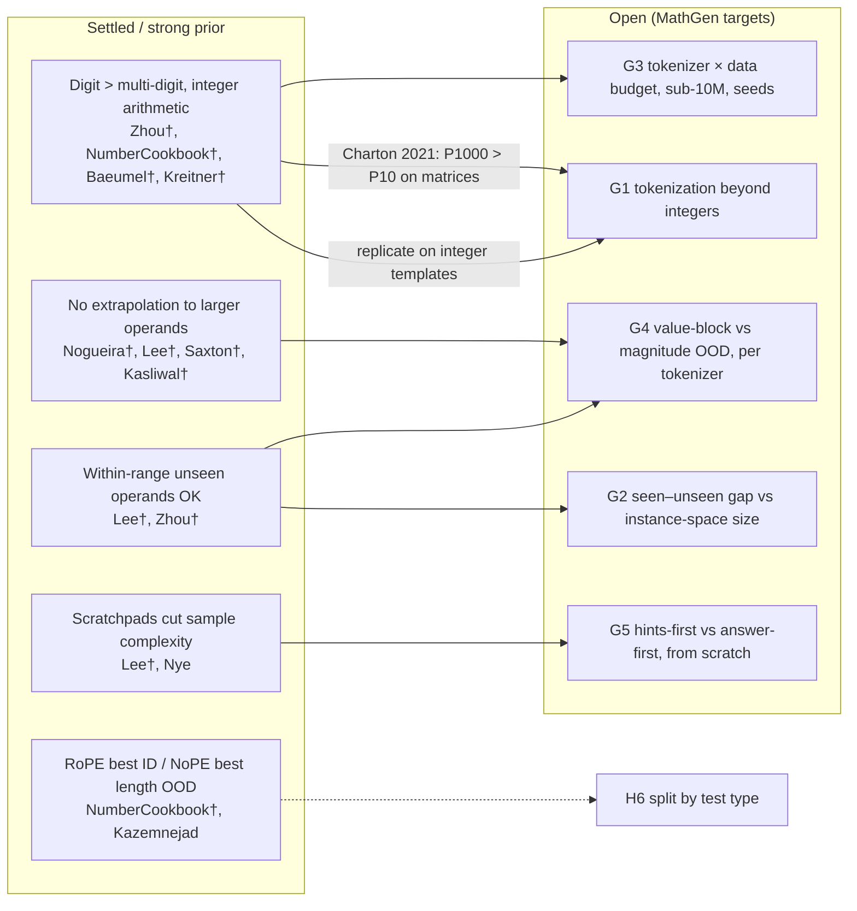

# MathGen — Research Gap (Milestone 2)

**Status:** complete. §6 contains a reframing of the research question. It keeps all four locked research areas (tokenization, memorization vs generalization, data efficiency, architecture ablations) and changes only their emphasis and the hypothesis wording. **The user adopted RQ v2 and all proposals on 2026-10-17**; they are frozen in the M3 pre-registration (`RESEARCH_DESIGN.md`).
**Evidence base:** [`LITERATURE_REVIEW.md`](LITERATURE_REVIEW.md) (92 verified references; search date 2026-10-17). Per-paper details are in [`RELATED_WORK_TABLE.md`](RELATED_WORK_TABLE.md). Papers marked † were checked in the full text.

---

## 1. Gap statement

> Prior work has established that number tokenization strongly affects arithmetic learned from scratch, and that single-digit tokens are the most data-efficient. That evidence comes almost entirely from **integer addition and multiplication**, trained **one task per model**, mostly in models of **70M parameters or more**, and mostly with **no seed variance reported**. The closest small-scale study (Baeumel et al. 2026†, ≈3.4M parameters, 10 seeds) covers three-digit addition only.
>
> Separately, small from-scratch models are known to generalize to unseen operands **within** the trained range and to fail **beyond** it. But no study we found measures how the gap between *seen* and *unseen* instances depends on the **size of each template's instance space** and on **repetition**, and none does so **jointly with a tokenization manipulation**.
>
> We found no study that trains sub-10M decoder-only models from scratch on a **multi-family** structured-math distribution (integer arithmetic, fractions, equations, 2-D vectors, 2×2 matrices, power-rule calculus, limits) and crosses tokenization with **instance-level** seen / unseen / held-out-value / out-of-range splits under a multi-seed, pre-registered design.

This is a gap in **coverage and control**, not a new phenomenon or method. Its value would come from showing **whether the known tokenization and generalization results transfer beyond integer arithmetic**, and from careful accounting of what is memorized.

---

## 2. Checked against the closest papers

Closeness is ranked by how many of these the paper shares with MathGen:
- (T) tokenization as a variable;
- (M) instance-level held-out split with seen-vs-unseen accounting;
- (S) multiple seeds with variance;
- (F) small from-scratch models on more than one math family.

| Paper | T | M | S | F | What it settles (we treat this as the prior) | What it leaves open (what MathGen adds) |
|---|---|---|---|---|---|---|
| **Baeumel et al. 2026†**, 2609.01386 (EMNLP 2026 main conference, confirmed in the official program) | ✔ 2×2 input/output | ~ (fixed held-out 500; no seen-vs-unseen comparison) | ✔ 10 seeds | ✗ addition only | Digit (fragmented) output beats whole-number output; the effect is output-side, at ≈3.4M parameters | Other task families; seen-vs-unseen accounting; data-budget interaction; OOD operands |
| **Zhou et al. 2024†**, 2409.17391 (Findings of EMNLP 2024) | ✔ base 10/10²/10³ | ✔ non-overlapping operand pairs; train ≈ eval accuracy | ✗ none stated | ✗ add/mult, 70M–12B | Base 10 is most data-efficient from scratch; extrapolation ≈ 0 | Sub-10M; families beyond integers; seeds; char arm and shared pre-tokenizer; held-out value blocks |
| **Yang et al. 2024 (Number Cookbook)†**, 2411.03766 | ✔ 1/2/3-digit | ✗ no seen-vs-unseen split | ~ 3 repeats for one PE table | ✗ 0.1B–3B (one 1.3M PE probe); one task per model | One-digit tokenizer best ID and OOD (gap closes at 3B); RoPE best ID, NoPE/ALiBi best length OOD; covers fractions, floats and scientific notation | Equations, vectors, matrices, calculus; memorization accounting; multi-family training; sub-10M tokenizer comparison |
| **Lee et al. 2023†**, 2307.03381 | ~ (char vs BPE only in a GPT-2 side experiment) | ✔ disjoint test sets + excluded-operand tests | ✗ none stated | ✔ 10.6M; +, −, ×, sin, sqrt; joint training | Within-length generalization to unseen/excluded operands; no length generalization; scratchpads cut sample complexity; phase transitions | A tokenization variable at small scale; seeds; templates with small instance spaces; structured outputs beyond numbers |
| **Saxton et al. 2019†**, 1904.01557 | ✗ char only | ~ probabilistic overlap bound (≤2%) | ✗ | ✔ ~30M, many modules | Multi-family synthetic math with interpolation/extrapolation sets; extrapolation is low | Tokenization; exact dedup and seen-vs-unseen; seeds; sub-10M |
| Kasliwal 2026†, 2610.09003 (preprint) | ✗ GPT-2 BPE | ✗ no dedup stated | ✗ single seed | ~ 10.6M non-embedding, but after WikiText pre-training | Bundled RoPE+RMSNorm+SwiGLU helps; 0% on 4-digit OOD | Pure from-scratch training; separate component ablations; seeds; tokenization |

**Result of the check:** none of the six combines all four of T, M, S and F. The closest three (Baeumel, Zhou, Number Cookbook) each fail on F, and two of them also fail on M or S. The gap statement survives the check.

---

## 3. What is already answered (we will not claim novelty here)

| Question | State of evidence | Consequence for MathGen |
|---|---|---|
| Does digit-level beat multi-digit tokenization for **integer** arithmetic from scratch? | Yes, consistently (Zhou†, Number Cookbook†, Kreitner†, Baeumel†). The size of the effect depends on data and scale (Nogueira†; Number Cookbook at 3B) | Our integer-arithmetic templates are a **replication**. The prediction is fixed in advance, and a failure to replicate is reportable |
| Is the effect input- or output-side? | Output-side, for 3-digit addition (Baeumel†) | Our tokenizer arms confound the two; proposal P-b adds a decoupled check |
| Do models extrapolate to longer or larger operands by default? | No (Nogueira†, Lee†, Saxton†, Zhou†, Kasliwal†, Welleck†) | H4b is expected to show collapse; a positive result would need strong evidence |
| Do small models generalize to unseen operands within range? | Yes, on large instance spaces (Lee†, Zhou†, Baeumel†) | H3′ is the prior for large-space templates |
| Do scratchpads improve sample efficiency? | Yes, strongly, for multi-step arithmetic (Lee†, Nye) | The hints-first/answer-first control is mostly a replication; the per-template step-count analysis is the new part |
| Does RoPE vs NoPE matter? | RoPE best ID; NoPE/ALiBi best length OOD (Number Cookbook†, Kazemnejad, McLeish†) | H6 is directional by test type |

---

## 4. What remains open (candidate contributions), ranked by confidence that it is open

| # | Open question | Closest coverage | Why still open | Confidence it is open |
|---|---|---|---|---|
| **G1** | Does the single-digit tokenization advantage hold **beyond integer arithmetic**, for fractions, 2×2 matrices and power-rule calculus, and in multi-family training? | Number Cookbook (fractions, floats, scientific notation; 0.1B+; one task per model); Charton 2021† (linear algebra: P1000 > P10, a counterexample) | No sub-10M comparison across these families. The Charton/Zhou disagreement is unexplained | High |
| **G2** | How does the **seen–unseen gap** depend on **instance-space size** and **exposure count** per template? | Magar & Schwartz (method, BERT on NL); Carlini (duplication, LMs); Charton & Kempe† (repetition helps) | Nobody varies instance-space size across templates in one model and measures seen vs unseen directly | High |
| **G3** | **Tokenizer × data-budget** interaction (distinct instances at a fixed number of examples seen) in sub-10M models, with seeds | Zhou† (data scale × base, no seeds, ≥70M); Nogueira† (representation effects vanish at 10M examples, pretrained T5) | Not at our scale, not multi-family, and data budget not separated from training budget | Medium–high |
| **G4** | **Within-range value-block holdout vs out-of-range operands** in one design, per tokenizer | Lee† (both, char only, no seeds); Zhou† (out-of-range only) | Not crossed with tokenization; not on non-integer families | Medium |
| **G5** | **Hints-first vs answer-first** in small from-scratch models, by number of solution steps | Lee† (formats, not answer position); Chen 2024 (answer-first, pretrained SLM fine-tuning); He 2026 (chain necessity, group word problems) | No small from-scratch comparison of answer position with worked-solution hints | Medium (narrow) |
| G6 | RoPE/SwiGLU effects at ~5M on structured math, ablated **one at a time** | Kasliwal† (bundled, one seed, pre-trained); Number Cookbook (PE only, ≥1.3M probe) | No separate, seeded SwiGLU-vs-GELU comparison on arithmetic at this scale | Medium, but likely a small or null effect |

---

## 5. Honest novelty assessment

- **Kind of contribution:** a controlled, multi-seed, pre-registered **replication-and-extension**. It takes established integer-arithmetic results to a broader structured-math distribution at very small scale, and adds explicit memorization accounting.
  - It doesn't introduce a method, an architecture or a new phenomenon.
  - Null results (H1 failing outside integers, H6′) would be informative and will be reported.
- **Strongest candidate findings:** G1 and G2. G1 directly tests whether a celebrated result generalizes. G2 turns the M1 audit's leakage problem (F5) into a measured quantity.
- **Weakest:** G6. It's likely null at this scale, and others cover nearby ground.
- **Risks to novelty:**
  - Three of the most relevant papers are under two months old (Baeumel, EMNLP 2026 main; Kasliwal and Satariyan, unreviewed preprints). Similar work may appear before MathGen finishes.
  - Forward-citation tracking wasn't possible (§6 of the review).
  - **Mitigation:** re-run the novelty search before writing results (M10), and log it.
- **Not claimed:**
  - that tokenization matters (known);
  - that small models can't extrapolate (known);
  - anything about LLM-scale models.

---

## 6. Is the research question already answered? Proposed reframing (for your decision)

The **combined** question is not answered. The literature does, however, answer the *integer-arithmetic slice* of H1, and it predicts outcomes for H4b and the output-order control. The current RQ wording ("how do number/subword tokenization … affect answer correctness") reads as if the basic effect were unknown. That overstates the novelty.

**Proposed RQ (v2, for approval at G2):**

> In ~5M-parameter decoder-only Transformers trained from scratch on a multi-family structured-math distribution:
> **(RQ-A)** does the single-digit number-tokenization advantage established for integer arithmetic hold for fractions, 2×2 linear algebra and power-rule calculus, and how does it change with the number of distinct training instances?
> **(RQ-B)** how large is the accuracy gap between seen and unseen instances, and how does it depend on a template's instance-space size and on repetition?
> **(RQ-C)** which of these effects survive held-out value ranges within the trained magnitude, and which collapse on larger operands?
> Secondary: positional-encoding and FFN ablations (one component at a time) and hints-first vs answer-first ordering.

**Hypothesis pairs, revised to match the evidence** (competing hypotheses are still held side by side):

| ID | Hypothesis | Competitor | Prior from the literature |
|---|---|---|---|
| H1a | Digit > bpe-num on integer templates (replication) | (null) | Strong |
| H1b | Digit > bpe-num on **non-integer** families too (fractions, matrices, calculus) | **H1b′** The advantage is confined to integer-arithmetic templates | Open; the Charton 2021 counterexample keeps H1b′ live |
| H1c | The digit advantage comes from **output** tokenization (decoupled check) | **H1c′** It comes from input tokenization | Output-side (Baeumel†) |
| H2 | Digit vs char (two-sided; same number tokens, so any difference reflects non-number text and length) | — | No number-representation effect expected |
| H3 | The seen–unseen gap is large for small-instance-space templates and **shrinks with coverage** | **H3′** Near-zero gap within range for all templates | H3′ likely for large spaces |
| H4a | Held-out value blocks within range generalize (gap ≈ 0) | **H4a′** Block holdout behaves like OOD | H4a (Lee Table 1) |
| H4b | All arms collapse on larger operands | **H4b′** Digit + RoPE keeps meaningful accuracy | H4b |
| H5 | Unseen-instance accuracy rises with N, with diminishing returns | — | Phase transitions expected (Lee†) |
| H5-tok | The digit-vs-bpe gap **shrinks** as N grows | **H5-tok′** The gap is constant or grows (as Zhou et al.† find for multiplication) | Mixed |
| H6-pe | RoPE ≥ NoPE (and ≥ learned) in-distribution; NoPE ≥ RoPE on length OOD | **H6-pe′** No detectable difference on either | Directional prior |
| H6-ffn | SwiGLU > GELU at matched parameters | **H6-ffn′** No difference beyond the pre-registered SESOI | Weak; H6-ffn′ live |
| C-AF | Hints-first > answer-first, and the gap grows with solution steps | No step-count dependence | Hints-first advantage expected |

*(Numbering follows the approved plan, H1–H6 + C-AF. Letters mark the refinements proposed here.)*

These revisions use only splits and arms already in the approved plan. The one possible addition is the decoupled input/output tokenization check (proposal P-b in the review, +6 runs).

---

## 7. Evidence map

